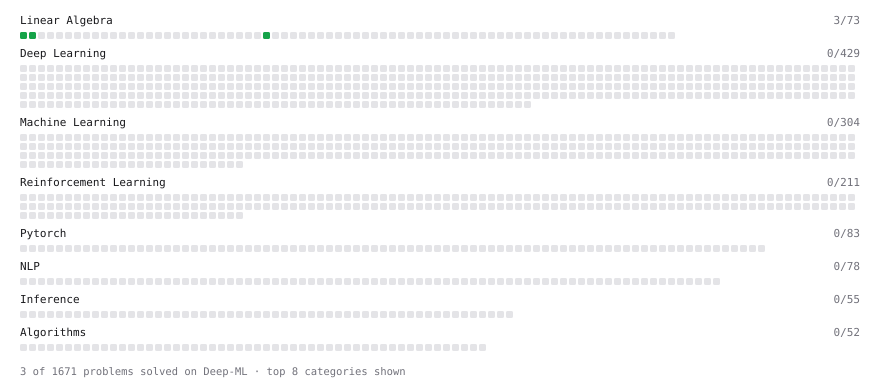

# Deep-ML

My machine learning practice from [Deep-ML](https://www.deep-ml.com). Every solution here was written by hand.

**1** solved · 0 problems · 0 labs · 1 math

[**Browse the interactive portfolio**](https://prrtsh0.github.io/deep-ml/) to replay this filling in over time.

## Math

| | Difficulty | Solved | |
| --- | --- | --- | --- |
| [Prefill and Decode in Different Datacenters: The Transfer Budget](https://www.deep-ml.com/math-problems/307) | easy | 2026-10-24 | [solution](math/0307-prefill-and-decode-in-different-datacenters-the-transfer-budget) |

---

_This file is regenerated by Deep-ML on every push._
